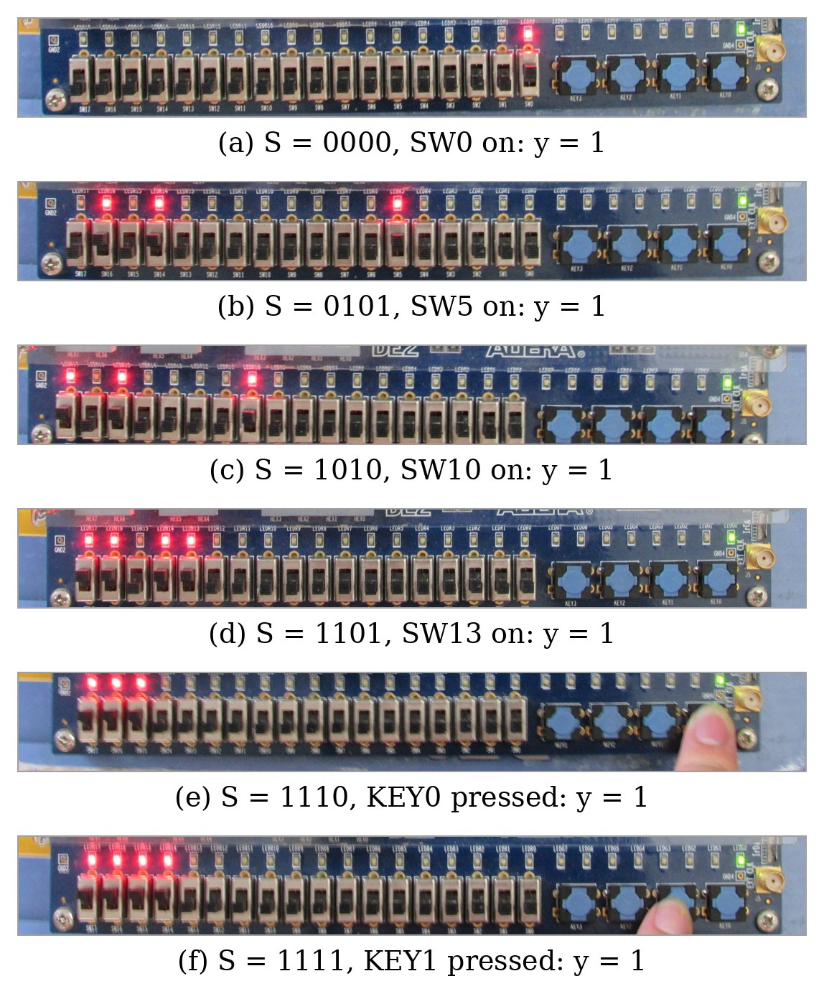

# Digital System Design Lab – Lab 1: Basic Combinational Logic Circuits in FPGA using Verilog

**Course:** EE117IU – Digital System Design Laboratory (International University, VNU-HCMC)
**Instructor:** Dr. Vo Minh Thanh
**Student:** Đặng Chí Thành – EEEEIU23023

Seven basic combinational circuits are described in Verilog HDL with three modeling styles
(dataflow, behavioral and gate-level/structural), simulated with ModelSim and implemented on an
Altera **DE2** board (Cyclone II **EP2C35F672C6**) with **Quartus II 9.0**.

| Experiment | Circuit | Models |
|---|---|---|
| [Ex1](Ex1_LogicGates) | 7 basic logic gates (AND, OR, NOT, NAND, NOR, XOR, XNOR) | Dataflow, Behavioral, Gate-level |
| [Ex2](Ex2_HalfAdder) | Half adder | Dataflow, Behavioral, Gate-level |
| [Ex3](Ex3_FullAdder) | Full adder | Dataflow, Behavioral (`case`), Structural |
| [Ex4](Ex4_RippleCarryAdder) | 4-bit ripple carry adder | Dataflow, Behavioral, Structural |
| [Ex5](Ex5_Mux2to1) | 2:1 multiplexer | Dataflow, Behavioral, Structural |
| [Ex6](Ex6_Mux4to1) | 4:1 multiplexer | Dataflow, Behavioral, Structural |
| [Ex7](Ex7_Mux16to1) | 16:1 multiplexer from five 4:1 multiplexers | Structural |

The full lab report is in [`report/`](report).

## Repository structure

```
ExN_<Circuit>/<Model>/
    <module>.v        circuit module
    lab1_exN.v        top-level module for the DE2 board (SW / KEY -> LEDG / LEDR)
    tb_<module>.v     self-checking testbench (prints the truth table and PASSED/FAILED)
images/
    kit/              photos of the FPGA results (one set per experiment)
    simulation/       ModelSim waveforms and transcripts
    compilation/      Quartus compilation report (Flow Summary)
report/               lab report
```

## I/O assignment on the DE2 board

In every top-level module the red LEDs mirror the switches (`assign LEDR = SW;`).
SW0 is the rightmost switch.

| Exp. | Inputs | Outputs |
|---|---|---|
| 1 | a = SW1, b = SW2 | AND = LEDG5, OR = LEDG4, NOT a = LEDG3, NAND = LEDG2, NOR = LEDG1, XOR = LEDG0, XNOR = LEDG6 |
| 2 | A = SW1, B = SW2 | S = LEDG0, Cout = LEDG1 |
| 3 | A = SW1, B = SW2, Cin = SW3 | S = LEDG0, Cout = LEDG1 |
| 4 | A = SW3–SW0, B = SW7–SW4, Cin = SW8 | Sum = LEDG3–LEDG0, Cout = LEDG4 |
| 5 | i0 = SW1, i1 = SW2, sel = SW3 | y = LEDG0 |
| 6 | i0–i3 = SW0–SW3, s0 = SW4, s1 = SW5 | y = LEDG0 |
| 7 | D0–D13 = SW0–SW13, D14 = KEY0, D15 = KEY1 (pressed = 1), S3–S0 = SW17–SW14 | y = LEDG0 |

## How to build and run

**FPGA (Quartus II 9.0)**
1. Create a project for one model folder, device **Cyclone II EP2C35F672C6**.
2. Add the circuit module(s) and `lab1_exN.v` (not the testbench); set `lab1_exN` as the top-level entity.
3. Import the DE2 pin assignment file (`DE2_pin_assignments.csv` from the DE2 System CD) and set unused pins to *As input tri-stated*.
4. Compile, then program the board with the generated `.sof` file (Tools → Programmer, USB-Blaster, JTAG).

**Simulation (ModelSim-Altera)**
1. Create a project in the model folder and add the circuit module(s) and `tb_<module>.v`.
2. Compile All, start simulation of `tb_<module>`, add the signals to the Wave window and run `run -all`.
3. The transcript prints the truth table and `RESULT: PASSED` when every output is correct.

## Results

All 19 models compiled with 0 errors, produced the expected LED outputs on the DE2 board, and all 19
testbenches reported **PASSED**. The three models of each experiment behaved identically, so one set of
photos and one waveform per experiment is shown.

| Exp. | FPGA result | Simulation |
|---|---|---|
| 1 | [kit](images/kit/Ex1_kit.jpg) | [waveform + transcripts](images/simulation/Ex1_sim.png) |
| 2 | [kit](images/kit/Ex2_kit.jpg) | [waveform + transcripts](images/simulation/Ex2_sim.png) |
| 3 | [kit](images/kit/Ex3_kit.jpg) | [waveform + transcripts](images/simulation/Ex3_sim.png) |
| 4 | [kit](images/kit/Ex4_kit.jpg) | [waveform + transcripts](images/simulation/Ex4_sim.png) |
| 5 | [kit](images/kit/Ex5_kit.jpg) | [waveform + transcripts](images/simulation/Ex5_sim.png) |
| 6 | [kit](images/kit/Ex6_kit.jpg) | [waveform + transcripts](images/simulation/Ex6_sim.png) |
| 7 | [kit](images/kit/Ex7_kit.jpg) | [waveform + transcript](images/simulation/Ex7_sim.png) |



## Corrections to the reference code

The reference code of the lab manual was kept unchanged except for the following fixes
(marked `[SUA]` in the source files):

| Exp. | Module | Problem | Fix |
|---|---|---|---|
| 1 | `allgate_BH` | `assign` inside an `always` block (not synthesizable) | removed `assign` |
| 1 | `lab1_ex1` | XNOR output not connected | added `LEDG[6]` |
| 3 | `full_adder_BH1` | missing `module` / `endmodule` | keywords added |
| 3 | `full_adder_BH1` | `case (A \| B \| Cin)` is a 1-bit OR, so the circuit acted as an OR gate | `case ({A,B,Cin})` |
| 3 | `full_adder_STRU` | port list `(a,b,cin,Cum,Carry)` did not match the declarations | `(A,B,Cin,Sum,Carry)` |
| 3 | `full_adder_STRU` | `or g5(Carry,x,y)` gives Carry = A ⊕ B | `or g5(Carry,y,z)` |
| 6 | `mux41beh_v1` | uses `s[0]` as the select MSB (swaps i1 and i2) | `mux41beh_v2` used instead |

The behavioral model of Ex4 and the structural model of Ex7 are not given in the lab manual and were written for this lab.
